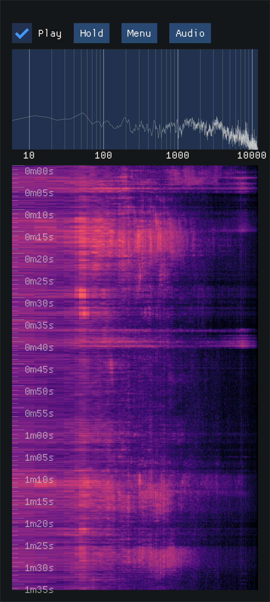

# Spectrogrammer

Spectrum Analyzer

## Features
- Runs on Android and Linux
- Frequency analysis
    - 4096 bands FFT 
    - configurable
       - decay
       - averaging
- Visualization    
   - Spectrogram
   - Waterfall
      - Uses a magma heatmap
      - When hold is active a binary heatmap is used to shows above/below values
   - Linear / Log scales for both axis
   - Hold function to capture refrence levels
      - Save/load/delete/rename for comparing 
- High performance, developed entirely in C/C++

## Screenshot


## Building
```
# clone with
git clone https://github.com/aguaviva/Spectrogrammer.git --recurse-submodules

# Build for Linux → Spectrogrammer-x86_64 (host arch suffix)
make

# Build for Android → Spectrogrammer-arm64-v8a.apk (default)
make BUILD_ANDROID=y

# 32-bit ARM APK → Spectrogrammer-armeabi-v7a.apk
make BUILD_ANDROID=y ARCH=armeabi-v7a

# Both ABIs as separate APKs
make BUILD_ANDROID=y ANDROID_ABIS="arm64-v8a armeabi-v7a"

# Install and run the default (arm64) Android build
make BUILD_ANDROID=y run
```

## Notes/stuff I need help with:
- Windows support
- should prob use Cnlohr audio libs :)

## credits
- cnlohr for [rawdrawandroid](https://github.com/cnlohr/rawdrawandroid)
- mborgerding for [kissfft](https://github.com/mborgerding/kissfft)

[def]: Screenshot.png
